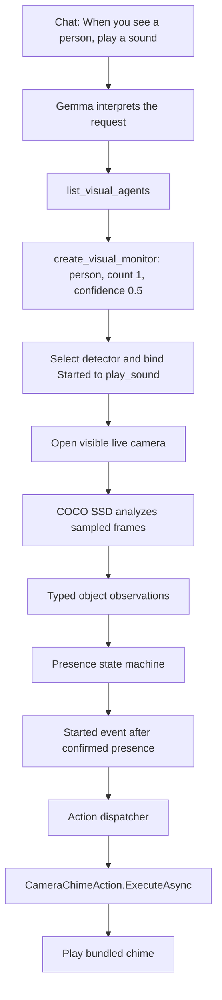

# Visual agents: from a chat request to an action

This guide describes the current MAUI demo implementation using the request:

> When you see a person, play a sound.

The chat model interprets the request and calls a tool to configure a monitor. The detector, event monitor,
and action dispatcher then run locally without calling Gemma for every frame.

**In this first version, sound is the monitor tool's preconfigured action. Chat does not yet discover and choose
among multiple actions.** The underlying runtime supports registered actions and explicit action identifiers.

## Workflow



### 1. The app registers detectors and actions

`BuildVisualMonitoring()` creates the registry and runtime:

```csharp
_visualAgents = new VisualAgentRegistry();
_visualAgents.Register(new CocoVisualAgent());
_visualChime = new CameraChimeAction();
_visualRuntime = new VisualMonitorRuntime(_visualAgents, new[] { _visualChime });
```

The detector advertises `object_detection` and its supported COCO classes, including `person`.
The sound action implements `IVisualAction` and declares:

```csharp
public string Id => "play_sound";
```

The runtime builds an action dictionary keyed by these registered identifiers.

### 2. Gemma interprets the request and calls tools

`VisualAgentTools.Instructions` tells the model how to configure an object-presence alert. The tool descriptions
explain available operations and the sound behavior of `create_visual_monitor`.

Gemma first calls `list_visual_agents` to inspect available capabilities and supported classes. It then calls
`create_visual_monitor` with arguments such as:

```json
{
  "label": "person",
  "minimumCount": 1,
  "confidence": 0.5
}
```

There is no `actionId` argument in this chat tool yet. The model chooses this tool because its description matches
the requested object-detection-and-sound workflow. It does not independently call a `play_sound` chat tool.

### 3. The host creates the rule and resolves its action

The tool invokes the page's `CreateVisualMonitorAsync`, which calls:

```csharp
_visualRuntime.CreateObjectMonitor(label, minimumCount, confidence);
```

That runtime method has these defaults:

```csharp
string actionId = "play_sound";
VisualEventPhase phase = VisualEventPhase.Started;
```

It creates an `ObjectCountCondition` and selects the first available registered object detector supporting the
canonical label. Currently that is COCO SSD MobileNet V3. Detector selection is deterministic registry lookup;
Gemma supplies the requested class rather than a detector implementation identifier.

`CreateMonitor(...)` then looks up `actionId` in the registered action dictionary and stores the resulting
`IVisualAction` instance with the rule. An unknown action identifier is rejected. The resulting configuration is:

| Part | Bound value |
|---|---|
| Source | Live camera |
| Detector | COCO SSD MobileNet V3 |
| Condition | At least one `person` with confidence at least `0.5` |
| Trigger phase | `Started` |
| Action identifier | `play_sound` |
| Action implementation | `CameraChimeAction` |

The host opens the live camera and returns the rule's actual status to chat. Model preparation may require a
download on first use. A returned `Preparing` or `Paused` status must not be described as already watching.
Equivalent create requests return the existing rule rather than adding duplicate alerts.

### 4. Frames become observations

The existing camera supplies raw frames to both the preview and the analysis path; the detector does not open
a second camera. Monitoring accepts at most five frames per second, with one in-flight frame and at most one
replaceable pending frame. Older pending frames are disposed instead of building a backlog.

`CocoVisualAgent` prepares the model, converts/resizes pixels for inference, and returns `VisualAnalysis` with
typed `VisualObservation` results. Object observations contain a canonical label, confidence and normalized box.
Frame/source identifiers and capture timestamps travel with the analysis.

The detector reports observations. It does not decide when to play a sound.

### 5. The presence monitor turns observations into events

`VisualPresenceMonitor` applies the condition over time:

| Event phase | Meaning |
|---|---|
| `Started` | Two positive observations within one second confirm presence. |
| `Updated` | The matching object count changes while the condition remains confirmed. |
| `Ended` | At least two negative observations spanning 1.5 seconds confirm absence. |

All events in one presence episode share an episode identifier. Brief missed detections do not immediately end
an episode. A gap over two seconds resets confirmation without inventing an `Ended` event. Failed analyses and
missing frames are not treated as proof that somebody left. Temporal decisions use monotonic capture timestamps.

These event phases are separate from the rule's lifecycle states: `Preparing`, `Watching`, `Paused`, `Stopped`,
and `Faulted`.

### 6. The dispatcher executes the bound action

When the monitor emits an event, the runtime compares its phase with the rule's trigger phase. This rule is
bound to `Started`, so `Updated` and `Ended` do not queue a sound.

A separate, bounded action dispatcher validates that the rule and visible-feed generation are still current,
then calls:

```csharp
await action.ExecuteAsync(occurrence, cancellationToken);
```

For `play_sound`, that instance is `CameraChimeAction`. It plays `Resources/Raw/visual_chime.wav` using the
platform's native audio player. Playback follows normal media-volume settings. The monitor card displays the
last event and action result, including playback failures. Actions are not automatically retried.

Gemma is not called again to approve or execute each sound. One confirmed episode produces one `Started` alert;
another person entering while somebody remains visible does not produce another chime. Confirmed absence rearms
the rule for the next episode. This is session-local dispatch, not a durable exactly-once delivery system.

## Visibility, controls and single images

- Monitoring runs only while the live camera feed is visible. Closing the feed, leaving the page or backgrounding
  pauses rules, cancels pending actions and releases the camera.
- Reopening the feed resumes enabled rules with fresh confirmation. A person still present can start a new episode.
  Explicitly user-paused rules remain paused until resumed.
- The monitor card and `control_visual_monitor` support pause, resume and remove. Detector faults require explicit
  resume to retry. Pending frames from before a resume cannot seed the new presence confirmation.
- Rules are kept in memory for the chat session. New chat discards them; they are not restored after app restart.
  Frames, observations and event history are not automatically saved. Ordinary chat requests/replies still follow
  the app's normal chat-storage policy.
- `analyze_visual_image` uses the same detector on an attached image reference such as `image-1`. It returns
  observations once, without advancing a temporal monitor or playing a sound.
- The separate `capture_camera_frame` tool sends a requested snapshot to a vision-capable chat model for description.
  Continuous detector monitoring does not send every frame to Gemma. Recognized scene text is untrusted data,
  never an instruction to execute.

## Extending action selection

The runtime already supports an explicit binding:

```csharp
runtime.CreateMonitor(agentId, condition, actionId, phase);
```

A future version can register more `IVisualAction` implementations, expose action descriptors through a discovery
tool, and add `actionId` plus validated action parameters to the monitor-creation tool. Gemma could then choose
among supported actions such as a chime, notification or snapshot. The host would validate the identifier and
parameters before binding the rule. Any action-specific authorization requirements would belong to that host action.

That discovery and parameter-selection layer is not implemented yet. Likewise, YOLO, face, OCR and plate-recognition
adapters remain future additions to the existing visual-agent contracts.

## Source map

| Component | Source |
|---|---|
| Chat tool schemas and planner instructions | [VisualAgentTools.cs](../../Emgu.LiteRT.LM.Agents/VisualAgentTools.cs) |
| MAUI registration, tool handlers and controls | [LiteRtLmChatPage.Visual.cs](LiteRtLmChatPage.Visual.cs) |
| Camera capture and visibility lifecycle | [LiteRtLmChatPage.Camera.cs](LiteRtLmChatPage.Camera.cs), [LiveCamera.cs](LiveCamera.cs) |
| Visual contracts and detector registry | [VisualAgents.cs](../../Emgu.LiteRT.LM.Agents/VisualAgents.cs) |
| Conditions and presence state machine | [VisualEvents.cs](../../Emgu.LiteRT.LM.Agents/VisualEvents.cs) |
| Rule binding, frame scheduling and action dispatch | [VisualMonitorRuntime.cs](../../Emgu.LiteRT.LM.Agents/VisualMonitorRuntime.cs) |
| COCO model adapter | [CocoVisualAgent.cs](CocoVisualAgent.cs) |
| Native chime playback | [CameraChimeAction.cs](CameraChimeAction.cs) |
| Regression tests | [UnitTestVisualAgents.cs](../../Emgu.LiteRT.Test/Emgu.TF.Lite.Test/UnitTestVisualAgents.cs) |
