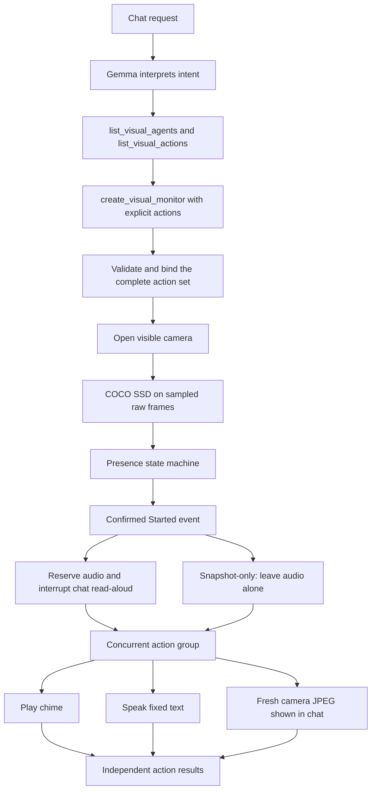

# Visual agents: from a chat request to an action

This guide describes the current MAUI demo implementation using the request:

> When you see a person, play a sound and say “Person detected”.

The chat model interprets the request and calls a tool to configure a monitor. The detector, event monitor,
and action dispatcher then run locally without calling Gemma for every frame.

Version 2 exposes action discovery and explicit validated action sets. A rule can play a chime, speak fixed words,
or capture a snapshot, with any requested combination running concurrently. No unrequested action is added.

## Workflow



### 1. The app registers detectors and action factories

`BuildVisualMonitoring()` registers `CocoVisualAgent`, `CameraChimeFactory`, `CameraSpeechFactory` and `CameraSnapshotFactory`.
Each action factory supplies a `VisualActionDescriptor` containing its stable ID, name, availability,
description and JSON parameter schema. Its side-effect-free `Bind` method validates parameters and creates
an immutable `VisualActionBinding`. Registration and binding do not play audio.

| ID | Parameters | Host implementation |
|---|---|---|
| `play_sound` | `{}` | `CameraChimeAction`, bundled `visual_chime.wav`, five-second timeout |
| `take_snapshot` | `{}` | `CameraSnapshotAction`, fresh camera JPEG, fifteen-second timeout |
| `speak_text` | `{ "text": "Person detected" }` | `CameraSpeechAction`, system speech, thirty-second timeout |

Speech must contain nonblank, pronounceable text of at most 200 characters. The host uses the existing speech
language selection and system voice. Explicit alert speech works even when chat read-aloud is off.

### 2. Gemma discovers capabilities and supplies explicit actions

`VisualAgentTools.Instructions` directs Gemma to call `list_visual_agents` and `list_visual_actions` first.
The monitor tool's `actions` array schema is generated from available registered action descriptors, including
an ID enum and the exact parameter schema for each alternative. For example, a combined sound-and-speech request becomes:

```json
{
  "label": "person",
  "minimumCount": 1,
  "confidence": 0.5,
  "actions": [
    { "actionId": "play_sound", "parameters": {} },
    { "actionId": "speak_text", "parameters": { "text": "Person detected" } }
  ]
}
```

Gemma chooses registered identifiers and literal speech text. There is no arbitrary code execution or
per-frame language-model decision. Only appearance (`Started`) is exposed through chat in this version.
Requests for disappearance, recurring alerts or dynamic spoken descriptions are unsupported.

### 3. The host validates and binds the entire rule

`CreateVisualMonitorAsync` calls:

```csharp
_visualRuntime.CreateObjectMonitor(label, actions, minimumCount, confidence);
```

The registry selects an available object detector supporting the canonical class. The action registry rejects
missing/empty action lists, unknown or unavailable IDs, repeated action types, invalid parameter objects and
unknown parameters. All actions must bind successfully before a rule is stored or the camera is opened.
Each rule can contain at most one action of each registered type. Speech parameters are normalized and copied
into a per-rule action, so another rule cannot change the words spoken by an existing rule.

Equivalent rules return the existing monitor. Identity includes detector, condition, trigger phase and the
normalized action set; reversing the order of the same actions does not create another rule. Different speech
text creates a different rule. Rules remain limited to eight per session.

The host opens the camera and returns actual status. First use may download the detector. `Preparing` and
`Paused` must not be described as already watching. The monitor card shows configured actions and each result.

### 4. Frames become observations

The existing camera supplies raw frames to both the preview and the analysis path; the detector does not open
a second camera. Monitoring accepts at most five frames per second, with one in-flight frame and at most one
replaceable pending frame. Older pending frames are disposed instead of building a backlog.

`CocoVisualAgent` uses the shared `CocoDetector` adapter on `Emgu.LiteRT.Models.CocoSsdMobilenetV3`
and LiteRT's **CompiledModel** API. It resizes BGR pixels before converting to RGB, writes a locked
input `TensorBuffer`, runs the compiled model, and returns `VisualAnalysis` with
typed `VisualObservation` results. Object observations contain a canonical label, confidence and normalized box.
Frame/source identifiers and capture timestamps travel with the analysis.

An optional second registration, `coco-yolox-nano`, uses `CocoVisualAgent(useYoloX: true)` and `YoloXDetector`.
Ask explicitly, for example: "Use YOLOX to watch for a person and play a sound." This path downloads the official
YOLOX-Nano weights from Emgu public S3 on first use, verifies SHA-256 and caches them, then runs them on the LiteRT GPU when that passes an accuracy and speed check against the CPU (else on CPU). It uses BGR float pixels, top-left padding, grid decoding and NMS before returning
the same observations to the monitor; the event/action pipeline is shared. It is experimental and was slower than V3
on the tested Mac and Pixel Fold. See [the evaluation](../../Emgu.LiteRT.Models/YOLOX_EVALUATION.md) for provenance and measured results.

Android/OpenCL and Mac Catalyst/Metal try GPU compilation with `Gpu | Cpu`: the model's custom
`TFLite_Detection_PostProcess` operation needs CPU execution. Before accepting GPU execution, the adapter
compares detections on the bundled `surfers.jpg` with compiled CPU results (class, score and box, allowing
0.05 score/coordinate differences and reordered results). Compilation/execution errors or a failed check
release the GPU model and fall back to compiled CPU. After accuracy passes, the adapter also compares
speed on the same bundled image resized to 640×480: three warmup runs per backend, then twelve timed
runs per backend with alternating CPU/GPU order. It uses median end-to-end detection latency, including
resize/color conversion, input/output transfers, inference and result extraction; compilation and image
decoding are excluded. GPU is accepted only when its median is strictly lower than CPU's. Ties or invalid
timings keep CPU. A slower GPU is released and CPU is prepared instead. Cancellation is checked between
runs and propagates without starting fallback. This adds a short benchmark to GPU preparation; results
reflect device load at preparation time and are not a sustained performance guarantee.
This is a startup sanity check, not comprehensive GPU accuracy certification. The monitor's detector name
shows the backend and whether GPU preparation failed; the photo demo shares the same adapter and has a
CPU/GPU-with-fallback picker. GPU selection is independent of Gemma's backend.

The live detector uses at most two CPU threads; the photo demo follows the app's CPU thread setting.
Pixel Fold testing found matching compiled CPU results, but inaccurate GPU results with this uint8 model,
including FP32 trials. The device therefore uses compiled CPU. See TODO #35 for measurements and follow-up.

The detector reports observations. It does not decide when to play a sound.

### 5. The presence monitor turns observations into events

`VisualPresenceMonitor` applies the condition over time:

| Event phase | Meaning |
|---|---|
| `Started` | Two positive observations within one second confirm presence. |
| `Updated` | The matching object count changes while the condition remains confirmed. |
| `Ended` | At least two negative observations spanning 1.5 seconds confirm absence. |

All events in one presence episode share an episode identifier. Brief missed detections do not immediately end
an episode. A gap over two seconds resets confirmation without inventing an `Ended` event. Failed analyses and
missing frames are not treated as proof that somebody left. Temporal decisions use monotonic capture timestamps.

These event phases are separate from the rule's lifecycle states: `Preparing`, `Watching`, `Paused`, `Stopped`,
and `Faulted`.

### 6. The dispatcher executes a concurrent action group

Only `Started` queues the rule's action group. The separate dispatcher keeps at most sixteen waiting event
groups. Groups execute FIFO; a full queue reports `Skipped` for every action in the dropped group.
Before starting, the dispatcher checks rule revision and visible-feed generation, then obtains an optional
`IVisualActionGroupCoordinator` lease. Each sibling action runs concurrently through `Task.WhenAll` with its
own exception handling. A failed chime does not stop speech, and a speech failure does not stop the chime.
The lease is released after all siblings and their cleanup complete. Actions are not automatically retried.

For groups containing `play_sound` or `speak_text`, the MAUI `AlertAudioCoordinator` reserves audio, cancels any chat read-aloud, and awaits its
native cleanup before allowing alert audio. Interrupted replies are not restarted. Chat speech arriving during
an alert waits until the whole group finishes; only the latest pending reply is retained. A chime and an alert
utterance can overlap, but two text-to-speech calls cannot. Alerts use normal media volume and the system voice.

Runtime snapshots expose `Actions` and `LastActionResults` (`Queued`, `Running`, `Succeeded`, `Failed`, `Cancelled`,
`Skipped`) for the latest scheduled group, with episode IDs and messages. Lifecycle changes cancel the whole
group. Late results from an older group or revision cannot overwrite the newest result. The old `ActionId` and
`LastAction` properties remain available as summaries for existing consumers.

Gemma is not called again for playback. One confirmed presence episode produces one group; additional people
during that episode do not retrigger it. Confirmed absence rearms the rule. This is session-local delivery.

### Snapshot alerts

Ask **“When you see a person, take a snapshot”**, or combine that with sound and/or fixed speech. The tool
selects `{ "actionId": "take_snapshot", "parameters": {} }`. Snapshot-only alerts do not reserve audio or
interrupt chat read-aloud. The action uses the existing live camera, waits for a fresh frame after the event,
and presents a JPEG thumbnail and time in the transcript. This is not the exact detector evidence frame; a
queued event can capture a later scene. Capture is serialized with chat camera requests so neither competes
for the camera snapshot slot. The action does not reopen a hidden camera.

Images remain in memory for the current chat session, including private chats. The newest twenty thumbnails
are retained; New chat or opening a saved chat clears them. They are not added to model context, chat
attachments, chat export or automatic photo storage. Tap an image to open it and choose **Save snapshot…**
to write a JPEG using the platform file picker. Saving is an explicit user action, including in private chat.
Closing/hiding the feed or pausing/removing the rule cancels pending capture/presentation. A capture failure
is reported independently and does not cancel audio siblings.

## Thinking and context capacity

The chat client budgets each model/tool round using the loaded context size, native cache occupancy and estimated
rendered input costs. With Thinking on, reasoning has a per-round budget (at most 256 tokens, smaller near the
limit). It can rebuild the cache between tool calls to omit completed thinking while retaining the current request
and all tool calls/results. Older completed exchanges can be removed when needed. This does not rerun actions.
Creation results return concise facts rather than repeating the full UI snapshot, leaving room for acknowledgement.

A rebuild can make a small-window request slower because retained text must be processed again. If essential
content cannot fit, the app gives context-window guidance. Empty native output is detected rather than presented
as a successful blank answer. This addresses the observed 4k/Thinking-on failure path; see TODO item 34 for
hardware validation and limits. Keep large tool results and catalogs concise to reduce pressure.

## Visibility, controls and single images

- Monitoring runs only while the live camera feed is visible. Closing the feed, leaving the page or backgrounding
  pauses rules, cancels pending actions and releases the camera.
- Reopening the feed resumes enabled rules with fresh confirmation. A person still present can start a new episode.
  Explicitly user-paused rules remain paused until resumed.
- The monitor card and `control_visual_monitor` support pause, resume and remove. Detector faults require explicit
  resume to retry. Pending frames from before a resume cannot seed the new presence confirmation.
- Rules are kept in memory for the chat session. New chat discards them; they are not restored after app restart.
  Frames, observations and event history are not automatically saved. Ordinary chat requests/replies still follow
  the app's normal chat-storage policy.
- `analyze_visual_image` uses the same detector on an attached image reference such as `image-1`. It returns
  observations once, without advancing a temporal monitor or playing a sound.
- The separate `capture_camera_frame` tool sends a requested snapshot to a vision-capable chat model for description.
  Continuous detector monitoring does not send every frame to Gemma. Recognized scene text is untrusted data,
  never an instruction to execute.

## Extending the framework

Implement `IVisualActionFactory` with a discoverable descriptor and strict, side-effect-free `Bind` validation;
return an `IVisualAction` plus normalized immutable parameters. Register factories before runtime/tool creation.
A host may supply `IVisualActionGroupCoordinator` to reserve shared resources around the entire group. The pure
managed core has no MAUI, camera, audio or detector-model dependencies.

Existing single-action constructors, `CreateMonitor(..., actionId, phase)` and sound-only tool overload remain
available. Use `LegacyInstructions` with the old five-tool overload; use `Instructions` with the six-tool overload
that adds action discovery. Hosts using source-generated JSON can pass serializer options to the new overload.
YOLO, face, OCR and plate recognition, notifications, persistent rules and background
monitoring remain future additions.

## Source map

| Component | Source |
|---|---|
| Context budgets and diagnostics | [LiteRtLmChatClient.cs](../../Emgu.LiteRT.LM.Extensions.AI/LiteRtLmChatClient.cs), [ContextManagement.cs](../../Emgu.LiteRT.LM.Extensions.AI/ContextManagement.cs) |
| Shared planner/catalog metadata | [ChatPlannerInstructions.cs](ChatPlannerInstructions.cs), [VisualHostCatalog.cs](VisualHostCatalog.cs) |
| Chat tool schemas and planner instructions | [VisualAgentTools.cs](../../Emgu.LiteRT.LM.Agents/VisualAgentTools.cs) |
| MAUI registration, tool handlers and controls | [LiteRtLmChatPage.Visual.cs](LiteRtLmChatPage.Visual.cs) |
| Camera capture and visibility lifecycle | [LiteRtLmChatPage.Camera.cs](LiteRtLmChatPage.Camera.cs), [LiveCamera.cs](LiveCamera.cs) |
| Visual contracts and detector registry | [VisualAgents.cs](../../Emgu.LiteRT.LM.Agents/VisualAgents.cs) |
| Conditions and presence state machine | [VisualEvents.cs](../../Emgu.LiteRT.LM.Agents/VisualEvents.cs) |
| Rule binding, frame scheduling and action dispatch | [VisualMonitorRuntime.cs](../../Emgu.LiteRT.LM.Agents/VisualMonitorRuntime.cs) |
| COCO model adapter | [CocoVisualAgent.cs](CocoVisualAgent.cs) |
| Action contracts, factories and validation | [VisualActions.cs](../../Emgu.LiteRT.LM.Agents/VisualActions.cs) |
| MAUI factories and fixed speech | [CameraActionFactories.cs](CameraActionFactories.cs) |
| Snapshot action | [CameraSnapshotAction.cs](CameraSnapshotAction.cs), [LiteRtLmChatPage.VisualSnapshots.cs](LiteRtLmChatPage.VisualSnapshots.cs) |
| Audio arbitration | [AlertAudioCoordinator.cs](../../Emgu.LiteRT.LM.Agents/AlertAudioCoordinator.cs) |
| Native chime playback | [CameraChimeAction.cs](CameraChimeAction.cs) |
| Regression tests | [UnitTestVisualAgents.cs](../../Emgu.LiteRT.Test/Emgu.TF.Lite.Test/UnitTestVisualAgents.cs) |
